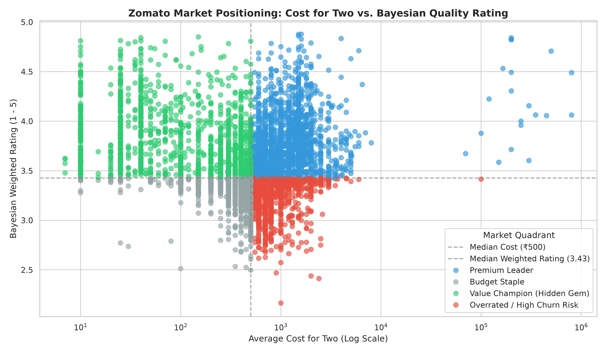
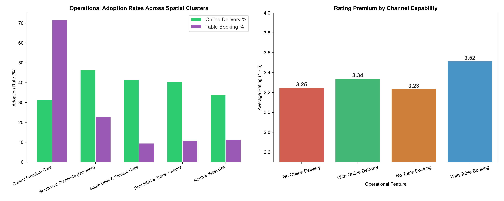

# Zomato Market Intelligence & Geospatial Analytics Engine

An end-to-end Python exploratory data analysis, spatial clustering, and operational intelligence pipeline. This project evaluates restaurant market positioning, price-to-quality dynamics, and consumer satisfaction across 9,551 establishments, with a deep spatial and operational focus on 5,653 active venues across the Delhi-NCR metropolitan region.

---

## Executive Summary & Strategic Findings

* **Market Pricing Distribution:** Evaluated against a catalog median cost of **₹500 for two**, the market segments into four distinct quadrants: **31.5% Budget Staples**, **25.3% Premium Leaders**, **24.7% Value Champions (Hidden Gems)**, and **18.5% Overrated / High Churn Risk**.
* **Spatial Polarization (K-Means Clustering):** Geospatial feature fusion segmented 5,653 NCR venues into 5 commercial corridors. The **Central Premium Core** (Connaught Place, Khan Market) commands a high spend tier (**₹2,129 average**) and quality floor (**3.80 Bayesian rating**), while outer residential corridors (Clusters 1 & 3) house over **55% of all venues** competing in a narrow **₹505–₹552** cost band.
* **The Table Booking Moat:** Table booking is available in only **17.4%** of venues catalog-wide, but is heavily concentrated in the Central Premium Core (**71.6%**). Venues with table booking command a **2.75× average cost premium** (₹1,613 vs. ₹587) and generate **2.71× higher vote engagement** (309.8 vs. 114.2 mean votes).
* **Online Delivery as a Volume Engine:** Online delivery adoption peaks in corporate corridors like **Gurgaon (46.6%)** and lifts average review volume by **36.6%** (177.2 vs. 129.8 votes) through post-order mobile app engagement loops.

---

## Visualizations & Analytical Artifacts

### 1. Market Positioning Matrix (Price vs. Bayesian Quality)


### 2. Geospatial Clustering & Spend Spread


### 3. Operational Channel Adoption & Rating Impact


---

## Mathematical Formulation

### 1. Bayesian Weighted Quality Calibration
To prevent low-volume restaurants with misleading raw scores (e.g., 5.0 with 3 reviews) from skewing quality distributions, ratings were calibrated using an IMDb-style Bayesian shrinkage formula:

$$WR = \left(\frac{v}{v + m}\right) R + \left(\frac{m}{v + m}\right) C$$

Where:
* $WR$: Bayesian Weighted Rating.
* $v$: Restaurant vote count.
* $m$: Minimum vote threshold evaluated at the 60th percentile ($m = 92$ votes).
* $R$: Raw restaurant aggregate rating.
* $C$: Overall catalog mean rating ($C = 3.44$).

### 2. Four-Quadrant Market Segmentation
Restaurants are segmented into strategic quadrants based on the dual coordinates of price and quality:

$$\text{Quadrant} = \begin{cases} \text{Value Champion (Hidden Gem)}, & \text{Cost} \le \text{Median}(\text{Cost}) \;\land\; WR \ge \text{Median}(WR) \\  \text{Premium Leader}, & \text{Cost} > \text{Median}(\text{Cost}) \;\land\; WR \ge \text{Median}(WR) \\  \text{Budget Staple}, & \text{Cost} \le \text{Median}(\text{Cost}) \;\land\; WR < \text{Median}(WR) \\  \text{Overrated / High Churn Risk}, & \text{Cost} > \text{Median}(\text{Cost}) \;\land\; WR < \text{Median}(WR) \end{cases}$$

### 3. Spatial-Commercial Feature Normalization & Weighting
Spatial coordinates were combined with commercial attributes into a normalized feature space for $K$-Means clustering:

$$\mathbf{X} = \begin{bmatrix} w_{\text{geo}} \cdot z(\text{Latitude}) \\ w_{\text{geo}} \cdot z(\text{Longitude}) \\ z(\text{Cost for Two}) \\ z(WR) \end{bmatrix}$$

Where $z(\cdot)$ denotes Z-score standardization ($\mu=0, \sigma=1$) and $w_{\text{geo}} = 1.75$ enforces spatial contiguity to prevent geographic fragmentation across metropolitan borders.

---

## Spatial Cluster Profiles

| Cluster | Classification & Key Localities | Venues | Delivery % | Booking % | Mean Cost | Mean Rating | Mean Votes |
| :---: | :--- | :---: | :---: | :---: | :---: | :---: | :---: |
| **0** | **Southwest Corporate** *(DLF Phase 3, Sector 14, Sohna Rd)* | 887 | 46.6% | 22.8% | ₹781 | 3.32 | 135.0 |
| **1** | **North & West Belt** *(Rajouri Garden, Rajinder Nagar, Pitampura)* | 1,672 | 34.0% | 11.2% | ₹505 | 3.24 | 103.3 |
| **2** | **East NCR & Trans-Yamuna** *(Sector 18 Noida, Mayur Vihar, Laxmi Nagar)* | 1,140 | 40.4% | 10.7% | ₹533 | 3.11 | 75.7 |
| **3** | **South Delhi & Student Hubs** *(Malviya Nagar, Kalkaji, Satyaniketan)* | 1,490 | 41.3% | 9.5% | ₹552 | 3.25 | 92.3 |
| **4** | **Central Premium Core** *(Connaught Place, Khan Market, Defence Colony)* | 464 | 31.3% | 71.6% | ₹2,129 | 3.90 | 693.1 |

---

## Repository Structure

```text
.
├── Zomato Restaurant Dataset.csv          # Raw international restaurant catalog
├── zomato_pricing_analysis.py            # Phase 1: Cleaning, Bayesian rating & quadrant modeling
├── geospatial_clustering.py              # Phase 2: NCR geospatial K-Means clustering & mapping
├── cluster_operations_analysis.py        # Phase 3: Channel adoption & operational impact pipeline
├── pricing_positioning_matrix.png        # Scatter plot: Cost for Two vs. Bayesian Rating
├── geospatial_clusters_map.png           # Map: NCR coordinate clusters & centroids
├── operational_impact_clusters.png       # Dual-panel bar chart: Adoption & rating premiums
├── zomato_market_positioning.csv         # Processed catalog with quadrant tags
├── zomato_geospatial_clustered.csv       # NCR catalog with cluster assignments
├── cluster_operational_metrics.csv       # Summary metrics per cluster
├── requirements.txt                      # Python dependencies
└── README.md                             # Architectural and mathematical documentation
```

Setup & Execution
Prerequisites
Python (>= 3.10)

Install dependencies:
pip install -r requirements.txt